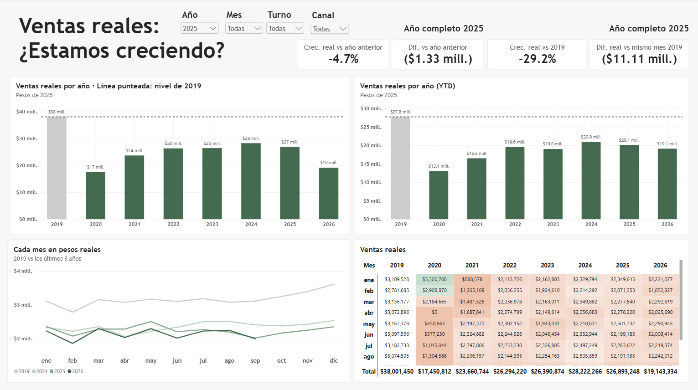
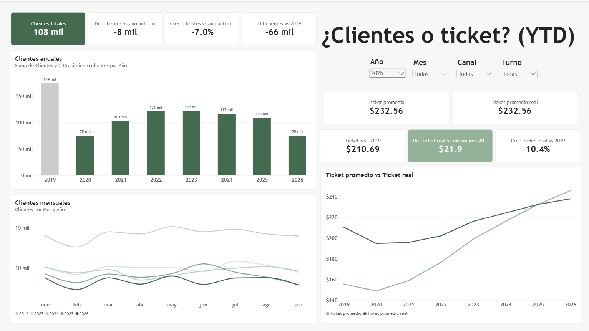
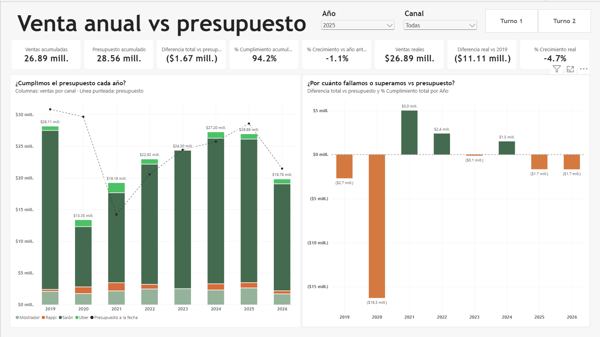
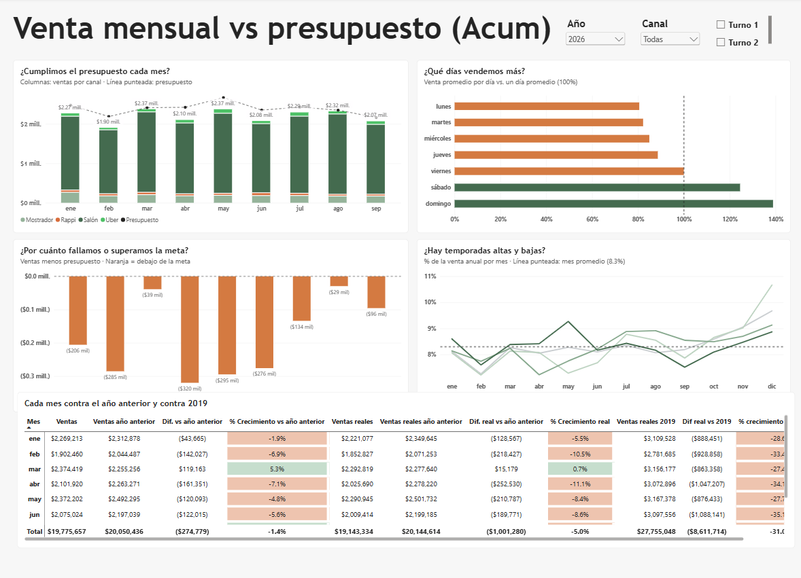
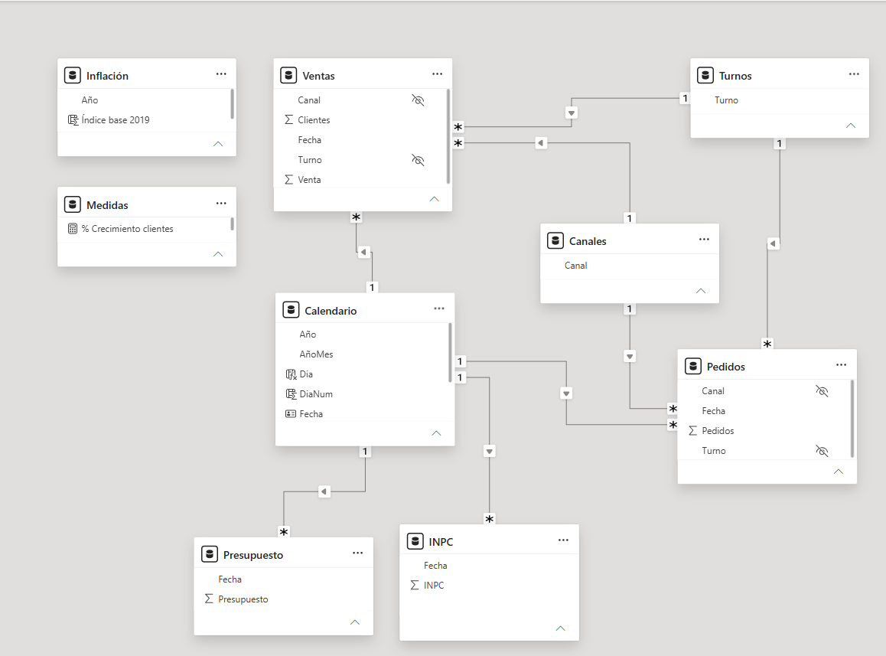

# Sales vs Budget & Inflation 

Is the restaurant really growing, or is it just inflation? Daily sales from January 2019 to September 2026
across four channels (dine-in, counter, Uber Eats, Rappi) and two shifts, compared against the monthly budget
and adjusted for inflation with Mexico's monthly CPI (INPC, INEGI).


## Business questions
1. Are we meeting the budget, monthly and year to date?
2. Are we growing in real terms or only because of inflation?
3. Are sales moving because of more customers or a higher ticket?
4. Which channels and shifts drive or drag sales?
5. Is the budget realistic?
 
## Key findings

- **No real recovery since 2019:** in constant pesos, 2025 sales were **29% below 2019**, and January–September 2026
  is **31% below** the same period of 2019. In nominal pesos, 2024 sold almost the same as 2019 despite ~34% cumulative inflation.



- **It's a traffic problem, not a price problem:** in-store customers fell **38%** (2025 vs 2019; 41% year to date in 2026),
  while the real in-store ticket is **~10% above 2019**. Price increases outpaced inflation; customers did not come back.



- **Budget:** 94% of budget in 2025 and 92% year to date in 2026. Budgets are set as last year's sales plus a fixed %, so a weak year produces an easy target (2021: 135%) and inflation alone consumes most of the targeted growth.
- **Delivery is not absorbing the loss:** app orders fell **19%** from 2024 to 2025.



- **Seasonality is weekly, not monthly:** weekends sell 24–38% above an average day; monthly seasonality is weak
  except for November–December.



## Dashboard pages
| Page | Question |
|---|---|
| Año (Annual) | Budget attainment and real sales by year vs the 2019 level |
| Mes (Monthly) | Monthly budget gap, day-of-week pattern, seasonality and a month-by-month comparison matrix |
| Real | Real sales by year (full and year-to-date) and by month vs 2019 |
| Ticket | Customers, in-store ticket (nominal vs real) |


## Data model
Star schema with two fact tables (`Ventas` daily × channel × shift, `Pedidos` monthly app orders) sharing
`Calendario`, `Canales` and `Turnos`. `Presupuesto` and `INPC` are monthly tables linked to the calendar on the first day of each month.



**Highlights**
- Power Query: unpivot + split + pivot to turn 12 wide columns into channel/shift/metric rows; month names converted to dates.
- **Comparable periods:** a dynamic cut-off date (last day with sales) so year-over-year and vs-2019 comparisons always use
  the same months, and the partial year is never compared against a full one.
- **Real values:** each month deflated with its own INPC; amounts expressed in pesos of the last full year (updates automatically).
- Time intelligence: `SAMEPERIODLASTYEAR`, `TOTALYTD`, `KEEPFILTERS`, `REMOVEFILTERS` on shared dimensions.

```DAX
Presupuesto a la fecha =
VAR UltimaVenta = CALCULATE(MAX(Ventas[Fecha]), ALL(Ventas), Ventas[Venta] > 0)
RETURN CALCULATE([Presupuesto], KEEPFILTERS(Calendario[Fecha] <= UltimaVenta))

Ticket promedio =
DIVIDE(CALCULATE([Ventas], KEEPFILTERS(Canales[Canal] IN {"Salón", "Mostrador"})), [Clientes])
```

## Methodology & data quality
- **Ticket definition:** in-store sales ÷ in-store customers. The client's original ticket divided total sales (including apps)
  by in-store customers only, which overstated it. App orders get their own ticket per order.
- Customer counts for two columns were swapped (counter shift 1 ↔ dine-in shift 2) and July–August 2019 customers were
  under-recorded; both were corrected with the client. [June 2019 / January 2021: pending review.]
- Counter sales spiked on May 27–31, 2025 (~15× a normal day); verified as correct.
- 2020–2021 reflect the pandemic. 2026 covers January–September.
- Inflation: INPC general index (INEGI); a restaurant-specific index could refine the real figures.

## Anonymization
All monetary amounts (sales and budget) were multiplied by an undisclosed constant factor. Percentages, growth rates
and comparisons are unchanged; absolute amounts are not the real ones. Customer and order counts are real.

## How to open
1. Clone the repo and open `sales-vs-budget.pbip` in Power BI Desktop.
2. Update the data source paths to the anonymized Excel files (Transform data → Source).